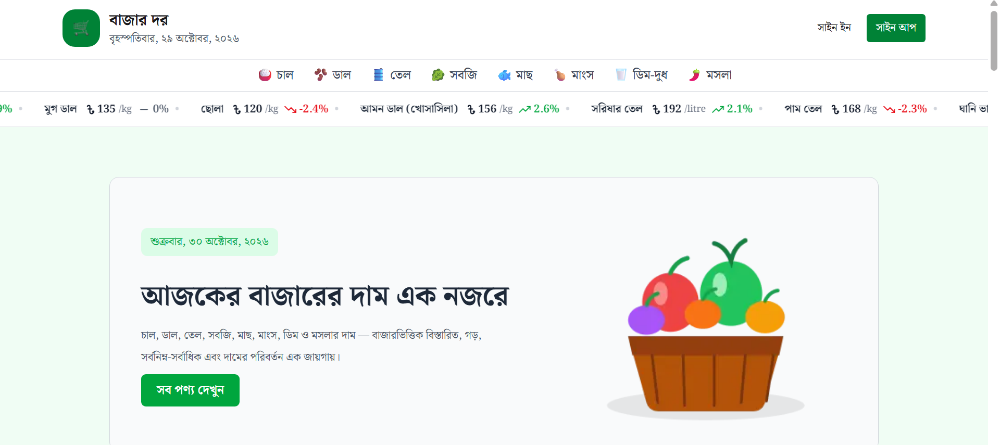

# 🛒 Bazar Dor — বাজার দর

### বাংলাদেশের নিত্যপ্রয়োজনীয় পণ্যের দৈনিক বাজারদর

**Bazar Dor** is a modern, responsive web application designed to help people in Bangladesh explore and compare the prices of everyday essential products.

Users can browse products by category, track price increases and decreases, view product details, and compare current prices with previous prices through a clean and user-friendly Bangla interface.

🌐 **Live Website:** [Bazar Dor](https://bazar-dor-psi-olive.vercel.app/)

📦 **GitHub Repository:** [asifdev62/bazar-dor](https://github.com/asifdev62/bazar-dor)

---

## 📸 Project Screenshot

<!-- Replace the image path below with your actual project screenshot. -->

<p align="center">
  
</p>

---

## ✨ Key Features

- 🏠 **Modern Homepage** — A clean and user-friendly homepage.
- 📈 **Price Increase Tracking** — Explore products with increased prices.
- 📉 **Price Decrease Tracking** — Find products with decreased prices.
- 🛍️ **All Products** — Browse available essential products in one place.
- 🗂️ **Category-Based Navigation** — Explore rice, lentils, oil, vegetables, fish, meat, eggs, and other categories.
- 🔍 **Product Details** — View individual product information and price history.
- 📊 **Price Comparison** — Compare current prices with previous prices.
- 🔄 **Market Trend Indicators** — Understand price movements through percentage changes and visual indicators.
- 🇧🇩 **Bangla Interface** — Designed for Bengali-speaking users.
- 📱 **Responsive Design** — Optimized for mobile phones, tablets, and desktops.
- ⚡ **Modern Web Experience** — Built with Next.js and React.

---

## 🛠️ Technology Stack

| Technology | Purpose |
|---|---|
| Next.js | React framework and application routing |
| React | Building interactive user interfaces |
| TypeScript | Type safety and maintainable code |
| Tailwind CSS | Styling and responsive layouts |
| React Icons | Icons and visual elements |
| REST APIs | Retrieving product and category data |
| MongoDB | Database integration for authentication, if configured |
| Better Auth | User authentication, if enabled in the application |
| Vercel | Application deployment |

> **Note:** The MongoDB and Better Auth entries are relevant only if they are part of the current implementation. Remove them if they are not used by this project.

---

## 🔌 API Integration

Bazar Dor uses REST APIs to retrieve product and category information.

### Categories API

```text
https://api.abcz.workers.dev/api/bazardor/categories
```

### Products API

```text
https://api.abcz.workers.dev/api/bazardor/products
```

The APIs provide the information required to display product names, categories, units, prices, historical prices, and price changes.

> API availability and the returned data depend on the API service.

---

## 📦 Dependencies

The project uses npm to manage its dependencies.

### Main Dependencies

| Package | Purpose |
|---|---|
| `next` | Next.js framework |
| `react` | UI library |
| `react-dom` | React DOM rendering |
| `typescript` | TypeScript support |
| `tailwindcss` | Utility-first CSS framework |
| `react-icons` | Icon library |

### Development Dependencies

Development dependencies may include:

- `eslint` — Code quality and linting.
- `eslint-config-next` — Next.js ESLint configuration.
- `@types/node` — Node.js type definitions.
- `@types/react` — React type definitions.
- `@types/react-dom` — React DOM type definitions.
- `typescript` — TypeScript compiler.

**Important:** The lists above describe expected dependencies. Check your `package.json` to confirm the packages and versions actually used by your project.

To install all project dependencies, run:

```bash
npm install
```

---

## 🚀 Getting Started

Follow these steps to run Bazar Dor on your local machine.

### Prerequisites

Make sure you have installed:

- [Node.js](https://nodejs.org/) — A supported LTS version.
- npm — Included with Node.js.
- Git — To clone the repository.

### 1. Clone the Repository

```bash
git clone https://github.com/asifdev62/bazar-dor.git
```

### 2. Navigate to the Project Directory

```bash
cd bazar-dor
```

### 3. Install Dependencies

```bash
npm install
```

### 4. Configure Environment Variables

If the project requires environment variables, create a `.env.local` file in the root directory.

For example:

```env
MONGODB_URI=your_mongodb_connection_string
```

Add only the environment variables required by your actual application. If your project does not require a MongoDB connection, you do not need this variable.

**Security:** Never commit real API keys, database credentials, or authentication secrets to GitHub.

### 5. Start the Development Server

```bash
npm run dev
```

### 6. Open the Application

Visit the following URL in your browser:

```text
http://localhost:3000
```

The application should now be available on your local machine.

---

## 📁 Project Structure

The following is an illustrative overview of the application structure. Update it to match the actual files in your repository.

```text
bazar-dor/
├── public/
│   └── images/
├── src/
│   └── app/
│       ├── api/
│       │   └── auth/
│       │       └── [...all]/
│       ├── category/
│       │   └── [slug]/
│       │       └── page.tsx
│       ├── components/
│       │   ├── products/
│       │   ├── BanglaDate.tsx
│       │   ├── Banner.tsx
│       │   ├── Footer.tsx
│       │   ├── Header.tsx
│       │   ├── Marque.tsx
│       │   ├── Navbar.tsx
│       │   └── UserInfo.tsx
│       ├── product/
│       │   └── [slug]/
│       │       └── page.tsx
│       ├── products/
│       │   └── page.tsx
│       ├── signIn/
│       │   └── page.tsx
│       ├── signUp/
│       │   └── page.tsx
│       ├── globals.css
│       ├── layout.tsx
│       └── page.tsx
├── .gitignore
├── package.json
├── package-lock.json
├── README.md
├── tsconfig.json
└── next.config.ts
```

---

## 📱 Responsive Design

Bazar Dor is designed to provide a consistent browsing experience across different devices.

- 📱 Mobile phones
- 📲 Tablets
- 💻 Laptops
- 🖥️ Desktop computers

---

## 🔮 Future Improvements

Potential improvements for future versions include:

- 🔎 Search products by name.
- ↕️ Sort products by price and category.
- 📍 Display market-specific prices and locations.
- 📈 Add interactive historical price charts.
- ⭐ Allow users to save favorite products.
- 🔔 Introduce notifications for significant price changes.
- 🗓️ Provide more historical price data.

---

## 👨‍💻 Developer

**Md Asif Ali**

Full-Stack Web Developer | Computer Science & Engineering

**Technologies:** JavaScript · TypeScript · React.js · Next.js · Tailwind CSS

- 💻 GitHub: [@asifdev62](https://github.com/asifdev62)
- 🌐 Portfolio: [Bazar Dor — Live Website](https://bazar-dor-psi-olive.vercel.app/)
- 📦 Repository: [Bazar Dor on GitHub](https://github.com/asifdev62/bazar-dor)

---

## ⭐ Support

If you find this project useful, consider giving the repository a star on GitHub!

---

<p align="center">
  <strong>Bazar Dor — বাজারদর জানুন, সচেতনভাবে বাজার করুন। 🇧🇩</strong>
</p>
