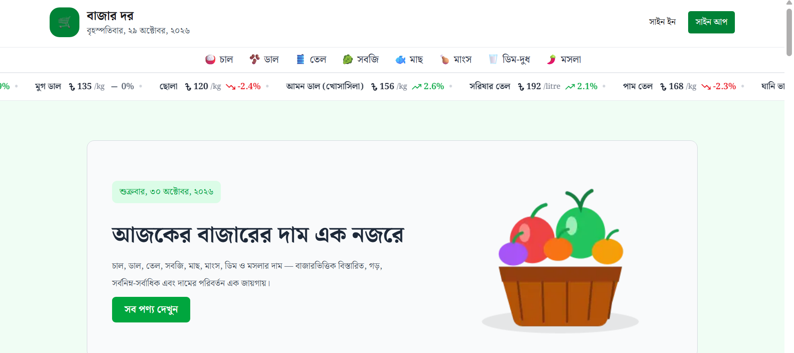

# 🛒 Bazar Dor — বাজার দর

<div align="center">

### বাংলাদেশের নিত্যপ্রয়োজনীয় পণ্যের দৈনিক বাজারদর 🇧🇩

A modern and responsive web application that helps people in Bangladesh explore, track, and compare the prices of everyday essential products.

<br />

[🌐 Live Demo](https://bazar-dor-psi-olive.vercel.app/) · [💻 GitHub Repository](https://github.com/asifdev62/bazar-dor)

<br />


</div>

---

## 🖥️ Homepage Preview

<div align="center">



*Bazar Dor — বাজারদর জানুন, সচেতনভাবে বাজার করুন।*

</div>

---

## 📖 About The Project

**Bazar Dor (বাজার দর)** is a modern and responsive web application designed to help people in Bangladesh explore and compare the prices of everyday essential products.

The platform provides a clean and user-friendly Bangla interface where users can browse products by category, track price increases and decreases, view product details, and compare current prices with previous prices.

Bazar Dor aims to make essential market price information more accessible and easier to understand through a simple digital experience.

### 🎯 Project Objectives

- Make everyday product prices easier to explore.
- Help users understand price increases and decreases.
- Organize essential products into convenient categories.
- Present market information through a Bengali interface.
- Provide a responsive experience across different devices.

### 🔗 Project Links

| Resource | Link |
|---|---|
| 🌐 Live Website | [Bazar Dor](https://bazar-dor-psi-olive.vercel.app/) |
| 💻 Source Code | [GitHub Repository](https://github.com/asifdev62/bazar-dor) |

---

## ✨ Key Features

- 🏠 **Modern Homepage** — A clean and user-friendly homepage.
- 📈 **Price Increase Tracking** — Explore products with increased prices.
- 📉 **Price Decrease Tracking** — Find products with decreased prices.
- 🛍️ **All Products** — Browse available essential products in one place.
- 🗂️ **Category-Based Navigation** — Explore rice, lentils, oil, vegetables, fish, meat, eggs, and other categories.
- 🔍 **Product Details** — View individual product information and price history.
- 📊 **Price Comparison** — Compare current prices with previous prices.
- 🔄 **Market Trend Indicators** — Understand price movements through percentage changes and visual indicators.
- 🇧🇩 **Bangla Interface** — Designed for Bengali-speaking users.
- 📱 **Responsive Design** — Optimized for mobile phones, tablets, and desktops.
- ⚡ **Modern Web Experience** — Built with Next.js and React.

---

## 🛠️ Technology Stack

### Frontend

<p>
  
</p>

| Technology | Purpose |
|---|---|
| Next.js | React framework and application routing |
| React | Building interactive user interfaces |
| TypeScript | Type safety and maintainable code |
| Tailwind CSS | Styling and responsive layouts |
| React Icons | Icons and visual elements |

### API & Data Integration

| Technology | Purpose |
|---|---|
| REST API | Retrieving product and category data |
| MongoDB | Database integration, if used by the current implementation |
| Better Auth | User authentication, if enabled in the application |

### Development & Deployment

<p>
  
</p>

- Git & GitHub
- Visual Studio Code
- Vercel

---

## 🔌 API Integration

Bazar Dor uses REST APIs to retrieve product and category information.

### Categories API

```text
https://api.abcz.workers.dev/api/bazardor/categories
```

### Products API

```text
https://api.abcz.workers.dev/api/bazardor/products
```

The APIs provide the information required to display:

- Product names
- Categories
- Units
- Current prices
- Historical prices
- Price changes

<sub>API availability and returned data depend on the external API service.</sub>

---

## 📦 Dependencies

The project uses npm to manage its dependencies.

### Main Dependencies

| Package | Purpose |
|---|---|
| `next` | Next.js framework |
| `react` | UI library |
| `react-dom` | React DOM rendering |
| `typescript` | TypeScript support |
| `tailwindcss` | Utility-first CSS framework |
| `react-icons` | Icon library |

### Development Dependencies

Development dependencies may include:

- `eslint` — Code quality and linting.
- `eslint-config-next` — Next.js ESLint configuration.
- `@types/node` — Node.js type definitions.
- `@types/react` — React type definitions.
- `@types/react-dom` — React DOM type definitions.
- `typescript` — TypeScript compiler.

*Check your `package.json` for the exact packages and versions used in the project.*

---

## 🚀 Getting Started

Follow these steps to run Bazar Dor locally.

### Prerequisites

Make sure you have installed:

- [Node.js](https://nodejs.org/)
- npm
- [Git](https://git-scm.com/)

### 1. Clone the Repository

```bash
git clone https://github.com/asifdev62/bazar-dor.git
```

### 2. Navigate to the Project Directory

```bash
cd bazar-dor
```

### 3. Install Dependencies

```bash
npm install
```

### 4. Configure Environment Variables

If the project requires environment variables, create a `.env.local` file in the root directory.

Add only the variables required by your actual application.

For example, if database integration is configured:

```env
MONGODB_URI=your_mongodb_connection_string
```

If the application does not require a MongoDB connection, this variable is not needed.

**Security:** Never commit real API keys, database credentials, or authentication secrets to GitHub.

### 5. Start the Development Server

```bash
npm run dev
```

### 6. Open the Application

Visit the following URL in your browser:

```text
http://localhost:3000
```

The application should now be available on your local machine.

---

## 📂 Project Structure

The following is an illustrative overview of the application structure.

```text
bazar-dor/
│
├── public/
│   └── images/
│
├── src/
│   └── app/
│       ├── api/
│       │   └── auth/
│       │       └── [...all]/
│       │
│       ├── category/
│       │   └── [slug]/
│       │       └── page.tsx
│       │
│       ├── components/
│       │   ├── products/
│       │   ├── BanglaDate.tsx
│       │   ├── Banner.tsx
│       │   ├── Footer.tsx
│       │   ├── Header.tsx
│       │   ├── Marque.tsx
│       │   ├── Navbar.tsx
│       │   └── UserInfo.tsx
│       │
│       ├── product/
│       │   └── [slug]/
│       │       └── page.tsx
│       │
│       ├── products/
│       │   └── page.tsx
│       │
│       ├── signIn/
│       │   └── page.tsx
│       │
│       ├── signUp/
│       │   └── page.tsx
│       │
│       ├── globals.css
│       ├── layout.tsx
│       └── page.tsx
│
├── .gitignore
├── package.json
├── package-lock.json
├── README.md
├── tsconfig.json
└── next.config.ts
```

*The structure is based on the provided project overview. Update it if your actual repository structure changes.*

---

## 📱 Responsive Design

Bazar Dor is designed to provide a consistent browsing experience across different devices.

- 📱 Mobile Phones
- 📲 Tablets
- 💻 Laptops
- 🖥️ Desktop Computers

---

## 🌐 Deployment

Bazar Dor is deployed using **Vercel**.

<details>
<summary><strong>Deployment Checklist</strong></summary>

1. Push the latest source code to GitHub.
2. Import the repository into Vercel.
3. Configure required environment variables.
4. Build and deploy the application.
5. Verify API connectivity.
6. Test the production website on different devices.

</details>

**Live Website:** [https://bazar-dor-psi-olive.vercel.app/](https://bazar-dor-psi-olive.vercel.app/)

---

## 🔮 Future Improvements

Potential improvements for future versions include:

- 🔎 Search products by name.
- ↕️ Sort products by price and category.
- 📍 Display market-specific prices and locations.
- 📈 Add interactive historical price charts.
- ⭐ Allow users to save favorite products.
- 🔔 Introduce notifications for significant price changes.
- 🗓️ Provide more historical price data.

---

## 🎯 What I Learned

Through this project, I gained practical experience with:

- Building modern web applications using Next.js.
- Developing responsive interfaces with React and Tailwind CSS.
- Writing maintainable code using TypeScript.
- Integrating external REST APIs.
- Displaying dynamic product information.
- Organizing products into categories.
- Presenting price changes and comparisons.
- Deploying applications using Vercel.

---

## 👨‍💻 Developer

<div align="center">

### Md Asif Ali

**Full-Stack Web Developer | Computer Science & Engineering**

JavaScript · TypeScript · React.js · Next.js · Tailwind CSS

<br />

<a href="https://github.com/asifdev62">
  
</a>

<br />

[GitHub Profile](https://github.com/asifdev62) · [Portfolio](https://myportfolio-eight-orcin-18.vercel.app/) · [Bazar Dor Live Website](https://bazar-dor-psi-olive.vercel.app/)

</div>

---

<div align="center">

### 🛒 Bazar Dor — বাজার দর

**বাজারদর জানুন, সচেতনভাবে বাজার করুন। 🇧🇩**

Built with ❤️ by Asif Ali

<br />

[🌐 Live Demo](https://bazar-dor-psi-olive.vercel.app/) · [💻 GitHub Repository](https://github.com/asifdev62/bazar-dor)

</div>
